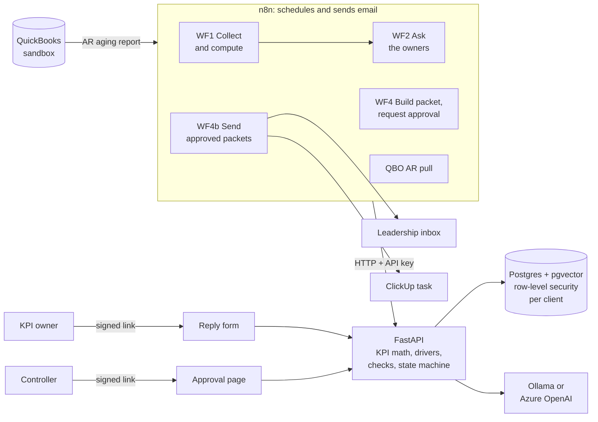

# KPI Scorecard Autopilot

**A weekly KPI report for a firm that does the books for many small companies,
assembled automatically, explained by the people responsible, and sent only
after a human approves it.**

**Demo video (2 min):** _coming soon_ <!-- replace with the video link -->  
**Project page:** _coming soon_ <!-- replace with the GitHub Pages link (docs/index.html) -->

Every week, a fractional CFO firm has to tell each client's leadership how the
business did: which numbers are off target, why, and what is being done about
it. Doing that by hand means chasing numbers, chasing explanations, and
writing the same report again and again.

This project does the routine parts:

1. **Collects the numbers** for each client and calculates the KPIs.
2. **Spots what's off target** and works out what moved it (for example, which
   two customers are paying late).
3. **Asks the person responsible** for each off-target KPI what happened, with
   a short note on what moved and a simple reply form.
4. **Assembles a one-page report** with their answers word for word.
5. **Sends it to leadership only after the firm's Controller approves it**, and
   exactly once.

AI helps write the short "what moved" notes, but it never does the math and
never guesses the reasons: the numbers come from code, the explanations come
from people, and every AI sentence is checked against the data before anyone
sees it.

> Portfolio project. All clients, people and numbers are fictional (synthetic
> data, plus a QuickBooks sandbox company).

## Demo walkthrough

1. **Monday:** the first workflow computes the week for two fictional clients.
   Brightline Services' *AR Over 60 Days* has jumped well past its target: red.
2. **The KPI owner gets an email** with a two-sentence note ("AR rose to
   $114,983.12 from $57,234.06; the largest movers were Ambercrest Logistics and
   Larkspur Clinics"), last year's explanation of a similar jump for reference,
   and a link to a four-question form: what changed, why, who owns the fix,
   what's being done.
3. **The owner answers** on the form.
4. **The packet is built:** a KPI table with colored status, then each red
   KPI's note and the owner's answers, quoted exactly. It is checked for any
   number, name, date or claim that doesn't match the data, then the Controller
   gets an approval link.
5. **The Controller approves** on the approval page.
6. **Leadership receives the packet once**, even if a workflow step is retried,
   and a task is logged in ClickUp ("Brightline Services: week of Aug 3, 2026
   packet sent", with who approved it and when).
7. **A live pull from a QuickBooks sandbox** loads real-format accounting data
   for a third client, with the same checks.

<!-- Screenshot: add docs/packet-email.png, then remove this comment's markers:

-->

## Results

From `python scripts/run_eval.py` (full report: [eval/results.md](eval/results.md)).
Synthetic data: 2 clients x 12 weeks, with planted events (late-paying
customers, a supplier price increase, a seasonal dip, an overstock purchase).

| Metric | Target | Result |
|---|---|---|
| KPI math accuracy vs. hand-computed | 100% | 100% (120/120) |
| KPI status vs. ground truth | 100% | 100% (120/120) |
| Planted events detected | all | 4/4 |
| False alarms across 24 client-weeks | ≤ 1 | 0 |
| Top driver = planted cause | ≥ 90% | 100% (10/10 event weeks) |
| AI-written notes match the data (after the check) | 100% | 100% (7/7; all passed on the first try) |
| Packets pass the faithfulness check | 100% | 7/7 |
| Retrieved past explanation relevant | ≥ 80% | 100% (4/4) |
| Query with no similar history returns nothing | 0 results | 0 |
| Cross-client data leaks | 0 | 0 (12 tables checked) |

These are measured on a small synthetic set designed around the planted
events; they show the system does what it's designed to do, not how it would
score on messy real-world data.

## How it works



- **n8n only schedules and sends emails.** It never touches the database or the
  AI model; every step is a call to the API, which writes every email itself.
- **The API is in charge.** KPI math is plain, tested Python using exact
  decimals (never the AI). A state machine enforces the order of steps, so a
  workflow mistake can't skip approval: the API refuses with an error.
- **AI describes, people explain.** The model gets pre-formatted numbers and may
  only say what moved. A checker rejects made-up numbers, unknown names, wrong
  dates, wrong directions ("rose" when it fell) and causal words ("because").
  A failing note gets one retry, then falls back to a template built only from
  computed numbers.
- **Approval is enforced by the database.** A run can't be marked sent without an
  approval of that exact packet version. Approval and reply links are signed,
  single-use and expiring; the Controller is identified from the database, never
  from the request.
- **Clients can't see each other's data.** Every table is protected by Postgres
  row-level security, and every query also filters by client.

Stack: n8n, FastAPI (Python 3.11), Postgres 16 + pgvector, Ollama
(`llama3.2:3b`, `nomic-embed-text`) or Azure OpenAI, QuickBooks Online
sandbox, ClickUp, Gmail SMTP. Workflow setup: [docs/n8n-setup.md](docs/n8n-setup.md).

## Run it

Prerequisites: Docker, Python 3.11+, and [Ollama](https://ollama.com) with
`ollama pull nomic-embed-text` and `ollama pull llama3.2:3b`.

```bash
cp .env.example .env          # fill in: passwords, API_KEY, LINK_SECRET (openssl rand -hex 32),
                              # and TEST_EMAIL_OVERRIDE=you@gmail.com (test mode)
docker compose up -d          # Postgres :5432, API :8000, n8n :5678 (all on 127.0.0.1)

python -m venv api/.venv && source api/.venv/bin/activate
pip install -e "api[dev]"
git config core.hooksPath .githooks   # blocks commits unless lint and all tests pass

python scripts/generate_synthetic.py  # data/seed/ (fixed seed, reproducible)
python scripts/migrate.py             # schema + row-level security
python scripts/seed_db.py             # clients, KPIs, 12 weeks of facts
python scripts/embed_docs.py          # KPI definitions, notes, last year's explanations

python scripts/setup_test_db.py       # separate test database (never the demo data)
cd api && pytest                      # ~540 tests; add --live to use the real models
cd .. && python scripts/run_eval.py   # writes eval/results.md
```

Then build the workflows in n8n (http://localhost:5678) following
[docs/n8n-setup.md](docs/n8n-setup.md), or import the exports in
`n8n/workflows/`.

**Rehearsing the demo:** `scripts/reset_demo_week.py` deletes one client's run
for a week so it can start over (dev only; dry run by default; refuses if
`EMAIL_MODE=live`):

```bash
python scripts/reset_demo_week.py --client brightline --week 2026-08-03        # shows what it would delete
python scripts/reset_demo_week.py --client brightline --week 2026-08-03 --yes  # deletes
```

## Landing page

`docs/index.html` is a one-page summary of the project (served by GitHub
Pages from `/docs`). It is `docs/template.html` filled with saved output of
the real API code, never live calls; only the fields the page shows are
embedded, and the only outside request is Google Fonts:

```bash
python scripts/capture_demo_data.py   # dry run on the TEST database, rolled back
                                      # -> data/demo/example_week.json (links scrubbed,
                                      #    fictional .example recipients only)
python scripts/build_demo_site.py     # docs/template.html -> docs/index.html
```

Set `VIDEO_URL`, `GITHUB_URL` and `LINKEDIN_URL` at the top of
`scripts/build_demo_site.py`, then rebuild.

## Design notes

**Retrieval threshold.** A past explanation is only shown when it is similar
enough (`RETRIEVAL_MIN_SIMILARITY=0.73`), so the system never claims "this
happened before" without evidence. 0.73 sits in the middle of the gap between
the weakest correct match (0.7685) and the strongest wrong one (0.6877).
**It is tuned on a small set** (4 correct pairs, 17 wrong ones); re-measure with
`python scripts/tune_retrieval.py` when the model or documents change.

**The faithfulness check is a safety net, not the control.** It catches common
AI mistakes automatically; the Controller's approval is the final control.

**Email safety.** The API refuses to start until an email mode is chosen:
`TEST_EMAIL_OVERRIDE=you@gmail.com` sends every email to plus-aliases of your
inbox with a "Test mode: originally addressed to ..." banner; `EMAIL_MODE=live`
sends to real addresses and must be set on purpose.

## Known limitations

- **Lowercase invented names aren't caught.** The checker finds names by
  capitalization, so a made-up "marketing spend" account slips through
  ("Marketing Spend" would be flagged).
- **Spelled-out numbers aren't checked.** "two customers" isn't verified;
  "2 customers" is, against the real counts.
- **The checks are heuristics tuned to the packet's style.** They fail closed
  (flag when unsure), which can mean false alarms on unusual phrasing.
- **The retrieval threshold is tuned on a small synthetic set.**
- **QuickBooks reports must use the default aging columns** (61-90, 91 and
  over); other settings are refused rather than guessed at.
- **Approval links prove access to the Controller's inbox,** not who clicked.
- **The evaluation uses synthetic data built around planted events.**

## Production hardening not done yet

Fine for a localhost prototype; needed before running this anywhere real:

- **Rate limiting** on failed API-key and link attempts.
- **Request logging** with request IDs (and no secrets or client data in logs).
- **Database connection pooling** (each request opens its own connection today).
- **API key rotation** (accepting two keys during a rotation window).
- **TLS / a reverse proxy**, if anything is exposed beyond localhost.
- **Real identity for approvers** (single sign-on).
- **Limiting what n8n nodes can read:** `$env` access is on, so any node can read
  n8n's encryption key.

Already in place: an API key on every route, startup checks for every
setting, ports bound to 127.0.0.1, pinned dependencies, a non-root API
container, row-level security, signed single-use links, and the
approval-before-send database trigger.

## Next steps

- **Webhook trigger for WF4b**, so sending can be started by a URL (designed and
  documented, not built).
- **ClickUp task for stuck sends settled with `resolve-claim`** (today only a
  normal send logs a task).
- **WF3 reminders** and **WF6 error alerts** in n8n (the API endpoints exist).
- **`/remember` and WF5:** store approved owner explanations so next year's
  packets can cite them.
- **Schedule triggers** for WF4 and WF4b (they run manually today).
- **An `/eval/run` endpoint** (the evaluation runs as a script today).
- **More QuickBooks reports** (P&L, balance sheet) for the sandbox client.

## About this project

I built this with Claude Code assistance, and designed the architecture, tests
and evaluation myself.
